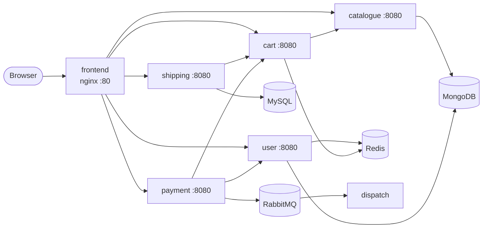

# roboshop-project

[](https://github.com/mukeshyadav143/roboshop-project/actions/workflows/ci.yml)
[](https://github.com/mukeshyadav143/roboshop-project/actions/workflows/e2e.yml)
[](LICENSE)

Bash scripts that deploy RoboShop, a sample microservices e-commerce app, on RHEL-family Linux (RHEL, Rocky, Alma, CentOS Stream, Fedora).



## Try the whole shop locally

With Docker installed, one command deploys all 11 tiers into Rocky Linux 9 containers using the scripts in this repo, then checks the shop works:

```bash
bash tests/e2e.sh          # deploy, test, clean up
KEEP=1 bash tests/e2e.sh   # same, but leave the containers running
```

## install.sh

Installs packages with `dnf`, safely enough to run again and again:

- skips packages that are already installed
- logs every step to `/var/log/roboshop/install.log`
- stops at the first failure and points you to the log
- `-n` dry run shows what would change without touching the system

```bash
git clone https://github.com/mukeshyadav143/roboshop-project.git
cd roboshop-project

bash install.sh -n nginx          # dry run
sudo bash install.sh nginx redis  # install specific packages
sudo bash install.sh              # default set: mysql nginx python3
```

Example output:

```text
2026-11-27 10:00:01 Installing: nginx redis
2026-11-27 10:00:01 SKIP: nginx is already installed
2026-11-27 10:00:19 OK: installing redis
2026-11-27 10:00:19 Done.
```

Set `LOG_DIR` to log somewhere else: `sudo LOG_DIR=/tmp/roboshop bash install.sh`.

## Deploy RoboShop, one script per server

`services/` sets up every tier of RoboShop on RHEL 9-family servers (Rocky, Alma, RHEL). Each script installs what the tier needs, writes a systemd unit, starts it, and is safe to run again.

| Script | Tier | Port | Needs |
|---|---|---|---|
| `mongodb.sh` | MongoDB 7.0 | 27017 | |
| `redis.sh` | Redis 7 | 6379 | |
| `mysql.sh` | MySQL 8 | 3306 | `MYSQL_ROOT_PASSWORD` |
| `rabbitmq.sh` | RabbitMQ | 5672 | `RABBITMQ_USER`, `RABBITMQ_PASS` |
| `catalogue.sh` | Node.js 20 API, loads product data once | 8080 | MongoDB |
| `user.sh` | Node.js 20 API | 8080 | MongoDB, Redis |
| `cart.sh` | Node.js 20 API | 8080 | Redis, catalogue |
| `shipping.sh` | Java (Spring Boot, built with Maven), loads city data once | 8080 | MySQL, cart, `MYSQL_ROOT_PASSWORD` |
| `payment.sh` | Python (uWSGI) | 8080 | cart, user, RabbitMQ, `RABBITMQ_USER`, `RABBITMQ_PASS` |
| `dispatch.sh` | Go worker | | RabbitMQ, `RABBITMQ_USER`, `RABBITMQ_PASS` |
| `frontend.sh` | Nginx: web UI and `/api/*` proxy | 80 | all APIs |

Run them in this order, each on its own server, and tell each script where the others are:

```bash
sudo bash services/mongodb.sh
sudo bash services/redis.sh
sudo MYSQL_ROOT_PASSWORD='choose-one' bash services/mysql.sh
sudo RABBITMQ_USER=roboshop RABBITMQ_PASS='choose-one' bash services/rabbitmq.sh

sudo MONGODB_HOST=10.0.0.11 bash services/catalogue.sh
sudo MONGODB_HOST=10.0.0.11 REDIS_HOST=10.0.0.12 bash services/user.sh
sudo REDIS_HOST=10.0.0.12 CATALOGUE_HOST=10.0.0.21 bash services/cart.sh
sudo MYSQL_HOST=10.0.0.13 CART_HOST=10.0.0.23 MYSQL_ROOT_PASSWORD='choose-one' bash services/shipping.sh
sudo CART_HOST=10.0.0.23 USER_HOST=10.0.0.22 RABBITMQ_HOST=10.0.0.14 \
     RABBITMQ_USER=roboshop RABBITMQ_PASS='choose-one' bash services/payment.sh
sudo RABBITMQ_HOST=10.0.0.14 RABBITMQ_USER=roboshop RABBITMQ_PASS='choose-one' bash services/dispatch.sh
sudo CATALOGUE_HOST=10.0.0.21 USER_HOST=10.0.0.22 CART_HOST=10.0.0.23 \
     SHIPPING_HOST=10.0.0.24 PAYMENT_HOST=10.0.0.25 bash services/frontend.sh
```

Unset host variables default to the plain names (`mongodb`, `redis`, `catalogue`, …), so with DNS records or `/etc/hosts` entries for those names you can drop them.

| Variable | Default | Used by |
|---|---|---|
| `MONGODB_HOST`, `REDIS_HOST`, `MYSQL_HOST`, `RABBITMQ_HOST` | `mongodb`, `redis`, `mysql`, `rabbitmq` | the services that use them |
| `CATALOGUE_HOST`, `USER_HOST`, `CART_HOST`, `SHIPPING_HOST`, `PAYMENT_HOST` | `catalogue`, `user`, `cart`, `shipping`, `payment` | cart, payment, shipping, frontend |
| `ARTIFACT_BASE`, `ARTIFACT_VERSION` | `https://roboshop-artifacts.s3.amazonaws.com`, `v3` | app services |
| `SKIP_SERVICE_START` | `0` | `1` installs and builds but starts nothing and loads no data, for baking machine images |

Where things go:

- application code in `/app`, run as the `roboshop` system user
- service settings in `/etc/roboshop/<service>.env`, readable by root only (passwords live here, not in the unit file)
- systemd units in `/etc/systemd/system/<service>.service`: check with `systemctl status catalogue` and `journalctl -u catalogue`
- script logs in `/var/log/roboshop/<script>.log`

Open the ports in the table between servers (security groups or `firewalld`). The MySQL script also creates `root@'%'` so shipping can load its data over the network: keep port 3306 closed to everything except the shipping server.

## Reuse the helpers

`lib/common.sh` holds the shared functions. Source it in your own scripts:

| Function | What it does |
|---|---|
| `require_root` | Exits unless running as root |
| `init_log` | Creates the log folder and file |
| `log "msg"` | Prints a timestamped line and appends it to the log |
| `validate $? "step"` | Logs OK, or logs the error and exits |
| `is_installed pkg` | True if the RPM package is installed |
| `die "msg"` | Logs an error and exits |
| `run "step" cmd…` | Runs a command quietly (output to the log) and validates it |
| `install_pkgs pkg…` | `dnf install`, skipping packages already present |

`lib/app.sh` adds the RoboShop app helpers: `app_user`, `app_download`, `write_env`, `write_unit`, `start_service`, `enable_module`, `nodejs_app`.

## Shell scripting examples

`shell-scripting/` holds short examples I wrote while learning Bash: variables, arrays, conditions, special variables (`$0`, `$@`, `$$`, `$?`) and the first version of the installer.

## Tests

Two workflows run on every push:

**E2E** runs `tests/e2e.sh`: every service script deploys its tier into its own systemd container, then the test checks through the frontend that all five APIs answer, catalogue serves products from MongoDB, shipping serves cities from MySQL, user gets ids from Redis, and dispatch is running.

**CI** runs:

- [ShellCheck](https://www.shellcheck.net/) on every script
- `install.sh` in a Rocky Linux 9 container: dry run changes nothing, a real install works, a second run skips the package, and an unknown package fails
- every script in `services/`, twice each, in Rocky Linux 9 containers with `SKIP_SERVICE_START=1`: packages install, Node.js dependencies install, shipping builds with Maven, dispatch builds with Go, nginx config passes `nginx -t`. the E2E workflow covers starting them

## Contributing

Issues and pull requests are welcome. See [CONTRIBUTING.md](CONTRIBUTING.md).

## Credits

RoboShop is based on [Instana's Robot Shop](https://github.com/instana/robot-shop) sample app. The scripts download its packaged code from the `roboshop-artifacts` S3 bucket.

## License

[MIT](LICENSE)
